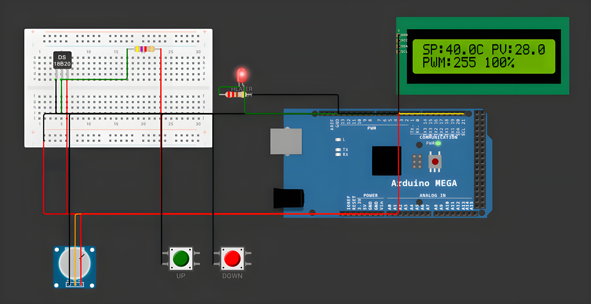

# PID Temperature Control System

<table align="center">
  <tr>
    <td align="center">
      
    </td>
  </tr>
</table>

## Overview

PID Temperature Control System is an embedded application for Arduino Mega that keeps a process
at a target temperature using a discrete PID controller. The temperature is measured with a
DS18B20 digital sensor, the controller output drives a heater through PWM, and the process state
is reported in real time on an LCD and over Serial.

## Features

- **PID Control**: Discrete PID controller with configurable `Kp`, `Ki` and `Kd` gains, executed
  at a fixed sample time of 1 s.
- **Anti-Windup**: The integral term is accumulated only when the output is not saturated (or when
  the error drives it back out of saturation) and is additionally clamped to ±100.
- **Derivative on Measurement**: The derivative term is computed from the measured temperature
  instead of the error, avoiding output spikes when the Set Point changes.
- **PWM Heater Output**: The controller output (0–255) drives the heating element, with the duty
  cycle displayed both as a raw value and as a percentage.
- **Set Point Adjustment**: A potentiometer sets the base Set Point in the 20–50 °C range, and the
  UP and DOWN buttons add a ±1 °C offset on top of it, with software debouncing (180 ms).
- **Real-Time Display**: Shows the Set Point, the current temperature and the PWM output on a 16x2
  I2C LCD.
- **Serial Reporting**: Sends the Set Point, the temperature and the PWM value every second as
  tab-separated values, compatible with the Arduino Serial Plotter.
- **Sensor Fault Protection**: If the sensor is disconnected or returns an out-of-range reading
  (below -50 °C or above 125 °C), the heater is switched off and an error is shown on the LCD.
- **Clean Architecture**: Sensor, PID controller, heater output, user input, and LCD display are
  separated into dedicated components for readability and reuse.

## Technologies

- **Platform**: Arduino Mega
- **Language**: C++ (Arduino Framework)
- **Libraries**: DallasTemperature, OneWire, LiquidCrystal_I2C
- **Build System**: PlatformIO
- **Simulation**: Wokwi
- **Development Tools**: Visual Studio Code + PlatformIO IDE
- **Version Control**: Git, GitHub

## Project Structure

```
src/
├── actuator/
│   ├── HeaterOutput.cpp
│   └── HeaterOutput.h
├── control/
│   ├── PIDController.cpp
│   └── PIDController.h
├── display/
│   ├── DisplayManager.cpp
│   └── DisplayManager.h
├── input/
│   ├── InputManager.cpp
│   └── InputManager.h
├── sensor/
│   ├── TemperatureSensor.cpp
│   └── TemperatureSensor.h
└── main.cpp
diagram.json
wokwi.toml
platformio.ini
```

## Control Logic

At every sample (`SAMPLE_MS = 1000`), the controller computes:

```
error  = SetPoint - Temperature
output = Kp * error + Ki * ∫error dt - Kd * d(Temperature)/dt
```

The output is limited to the 0–255 range and applied as the PWM duty cycle of the heater.

Default tuning values:

| Parameter | Value | Description |
|---|---|---|
| `Kp` | 18.0 | Proportional gain |
| `Ki` | 0.8 | Integral gain |
| `Kd` | 2.0 | Derivative gain |
| `SAMPLE_MS` | 1000 | Sample time in milliseconds |
| Output range | 0–255 | PWM duty cycle |
| Integral limit | ±100 | Anti-windup clamp |

The gains are set in `setup()` in `src/main.cpp` through `PIDControllerInit()` and can be adjusted
to match the thermal behavior of the controlled process.

## Set Point

The effective Set Point is built from two inputs:

```
SetPoint = clamp(20 + (potentiometer * 30 / 1023) + offset, 20, 50)
```

- The potentiometer provides the base value between 20 °C and 50 °C.
- Each press of **UP** increases `offset` by 1 °C, and each press of **DOWN** decreases it by 1 °C.
- The final value is always limited to the 20–50 °C range.

## Pin Mapping

| Component | Pin | Action |
|---|---|---|
| DS18B20 temperature sensor | 8 | 1-Wire data (4.7 kΩ pull-up to 5V) |
| Potentiometer | A0 | Sets the base Set Point (20–50 °C) |
| BTN_UP | 4 | Increases the Set Point by 1 °C |
| BTN_DOWN | 5 | Decreases the Set Point by 1 °C |
| Heater output (PWM) | 10 | Heater power (LED in the simulation) |
| LCD (I2C, 0x27) | SDA 20 / SCL 21 | Displays Set Point, temperature and PWM |

## Resources

- [Wokwi Documentation](https://docs.wokwi.com/)
- [PlatformIO Documentation](https://docs.platformio.org/)
- [DallasTemperature Library](https://github.com/milesburton/Arduino-Temperature-Control-Library)
- [OneWire Library](https://github.com/PaulStoffregen/OneWire)
- [LiquidCrystal_I2C Library](https://github.com/marcoschwartz/LiquidCrystal_I2C)

## Installation

To build and run the application, follow these steps:

1. **Clone this repository:**
```bash
git clone https://github.com/Constantin-Stamate/pid-temperature-control
```

2. **Navigate to the project directory:**
```bash
cd pid-temperature-control
```

3. **Open the project in VS Code with the PlatformIO extension installed**

4. **Build the firmware** (PlatformIO downloads the required libraries automatically):
```bash
pio run
```

5. **Upload to the board, or run the Wokwi simulation:**
```bash
pio run --target upload
```
For the simulation, open `diagram.json` in VS Code with the Wokwi extension and start the
simulator. It loads the firmware built at `.pio/build/megaatmega2560/firmware.hex`, as configured
in `wokwi.toml`.

6. **Interact with the system:**
```
Potentiometer -> sets the base Set Point (20-50 °C)
BTN_UP        -> increases the Set Point by 1 °C
BTN_DOWN      -> decreases the Set Point by 1 °C
Sensor        -> change the temperature (in Wokwi, click the DS18B20 and move the slider)
```

7. **Observe the result:** the PWM output increases when the temperature is below the Set Point
and decreases as it approaches it, while the LCD and the Serial Monitor display the Set Point, the
temperature and the PWM value.

## Contributors

**PID Temperature Control System** was developed as part of the Internet of Things laboratory
works.

- GitHub: [Constantin-Stamate](https://github.com/Constantin-Stamate)
- Email: constantinstamate.r@gmail.com